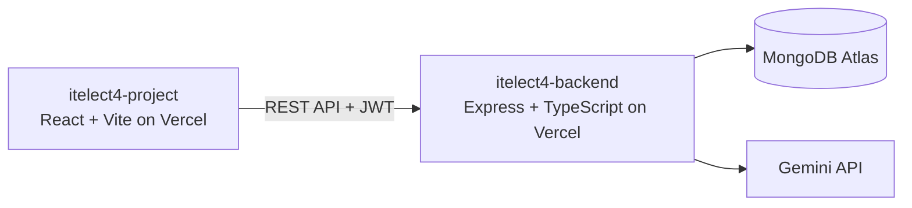

# ITELECT4 Backend

[](https://github.com/angelomarasigan798-sys/itelect4-backend/actions/workflows/ci.yml)

The Express and TypeScript API for the ITELECT4 appointment app. It provides
JWT-authenticated account, appointment, submission, and AI-review routes. The
AI Review route validates project descriptions and returns structured Gemini
feedback; the Gemini key stays on the server.

- **Live API:** https://itelect4-backend-nu.vercel.app
- **Health check:** https://itelect4-backend-nu.vercel.app/api/health
- **Live frontend:** https://itelect4-project.vercel.app
- **Frontend:** https://github.com/angelomarasigan798-sys/itelect4-project

## Architecture



## Run locally

Use Node.js 24 and npm. Copy `.env.example` to `.env`, then set the backend's
MongoDB URI, JWT secret, CORS origin, and Gemini API key in the private `.env`
file. Never commit `.env` or expose `GEMINI_API_KEY` in the frontend.

```powershell
npm ci
Copy-Item .env.example .env
npm run dev
```

The API listens on port 4000 by default. `npm run try-ai` sends a sample prompt
to Gemini and consumes the project's Google quota.

## Checks

```powershell
npm run typecheck
npm test
npm run build
```

GitHub Actions runs type checking and tests on every push. Add `JWT_SECRET` as
a repository Actions secret so the CI test can sign its test token.

## AI-use disclosure

AI assistance was used to help implement and verify the tests, CI workflows,
and this documentation. The repository owner should review and be prepared to
explain every change before submission.
